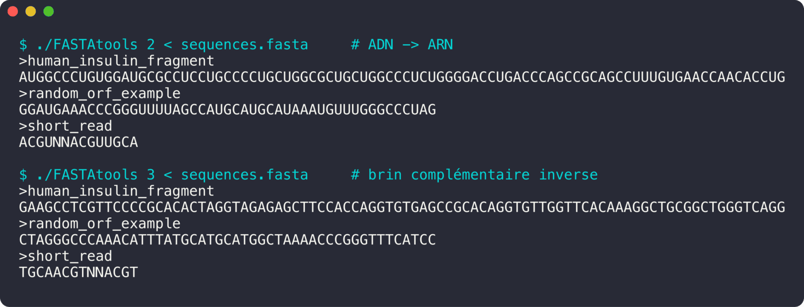

<div align="center">

# FASTAtools

**Quelques outils de bio-informatique pour des séquences ADN.**

  

<sub>Projet solo · 2023</sub>

</div>

<br/>

<p align="center"></p>

## Le projet en quelques mots

Un petit outil en ligne de commande qui lit des séquences au format **FASTA** et les transforme.

## Ce que ça fait

- Option 1 : affichage normalisé (majuscules, caractères invalides retirés)
- Option 2 : transcription ADN → ARN
- Option 3 : brin complémentaire inverse
- Séquences d'exemple dans [`examples/`](examples)
- Tests unitaires Criterion

## Lancer le projet

```bash
make
./FASTAtools 2 < examples/sequences.fasta
./FASTAtools 3 < examples/sequences.fasta
```
